<p align="center">
  <a href="https://seoskills.io">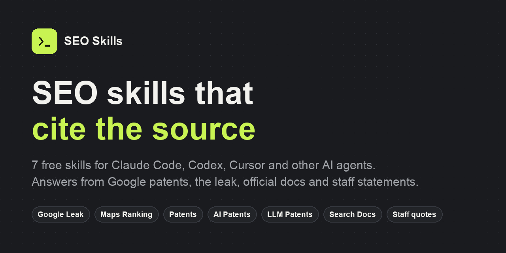</a>
</p>

<p align="center">
  <a href="LICENSE"></a>
  <a href="#the-seven-skills"></a>
  <a href="#install"></a>
  <a href="#mcp-server"></a>
  <a href="https://agentskills.io"></a>
  <a href="https://seoskills.io"></a>
</p>

# SEO Skills for Claude Code, Codex, Cursor and other AI agents

**Seven free SEO skills, packaged as a Claude Code SEO plugin and an MCP server, that make your AI agent answer from primary sources instead of memory.** Each skill gives the agent a searchable archive: the leaked Google Content Warehouse API documentation, Google's search patents, Google and Alphabet AI patents, LLM patents, Google's official search documentation, public statements by Google's search team, and the sources behind Google Maps ranking. The agent searches the archive, quotes the field, the claim or the passage, and tells you what the source does not show.

Works with **Claude Code**, the **Claude apps**, **Codex**, **Cursor**, **Gemini CLI**, **GitHub Copilot in VS Code** and **OpenCode**, and as a remote **MCP server**.

Install all seven in Claude Code:

```text
/plugin marketplace add mirackacmazcom/seo-skills
/plugin install seo-skills@seo-skills
```

Other ways to install, and other agents: [Install](#install).

<p align="center">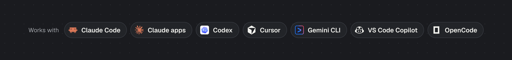</p>

[Website](https://seoskills.io) · [Install guide](https://seoskills.io/install/) · [All skills](#the-seven-skills) · [Answer settings](#answer-settings) · [MCP server](#mcp-server) · [FAQ](#faq)

<p align="center">
  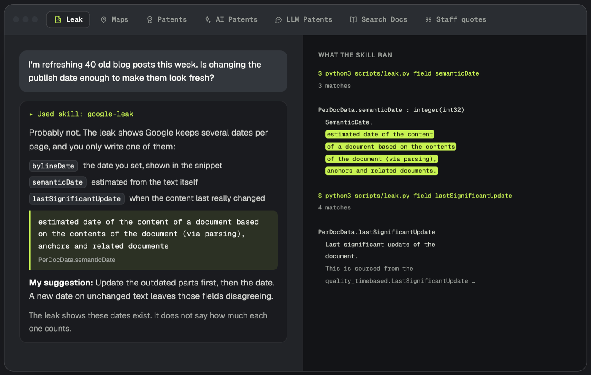
</p>


## Contents

- [Why use these skills](#why-use-these-skills)
- [The seven skills](#the-seven-skills)
- [Install](#install)
- [How to use the skills](#how-to-use-the-skills)
- [Answer settings](#answer-settings)
- [MCP server](#mcp-server)
- [How it works](#how-it-works)
- [What each kind of source can and cannot show](#what-each-kind-of-source-can-and-cannot-show)
- [FAQ](#faq)
- [License](#license)

<p align="center">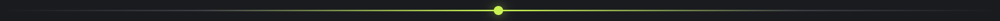</p>

## Why use these skills

A model answering an SEO question from memory repeats what blog posts said about Google. It cannot show you the passage it relies on, it blends patents, leaks and official advice into one answer, and it sounds just as sure when it is wrong.

<p align="center">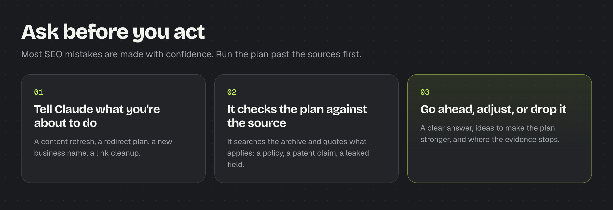</p>

With a skill, the agent **checks your plan against the source before you act**: tell it what you are about to do, and it searches the archive, quotes what applies, suggests what to change and says where the evidence stops.

- *"I'm refreshing 40 old blog posts. Is changing the publish date enough?"*
- *"The client wants to add the city to their Google Business Profile name."*
- *"An audit tool flagged 300 toxic links. Should I disavow them?"*
- *"We're generating 500 location pages with AI. Will Google treat that as spam?"*
- *"How does ChatGPT search decide which pages to cite?"*

<p align="center"></p>

## The seven skills

<table>
<tr>
<td width="50%"><a href="skills/google-leak">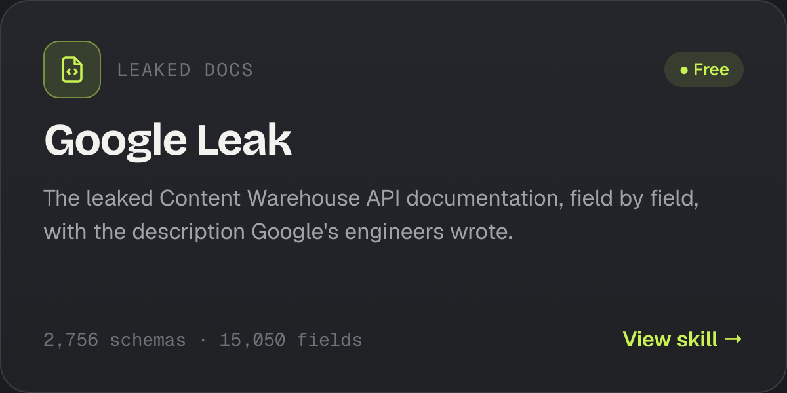</a></td>
<td width="50%"><a href="skills/google-maps-ranking">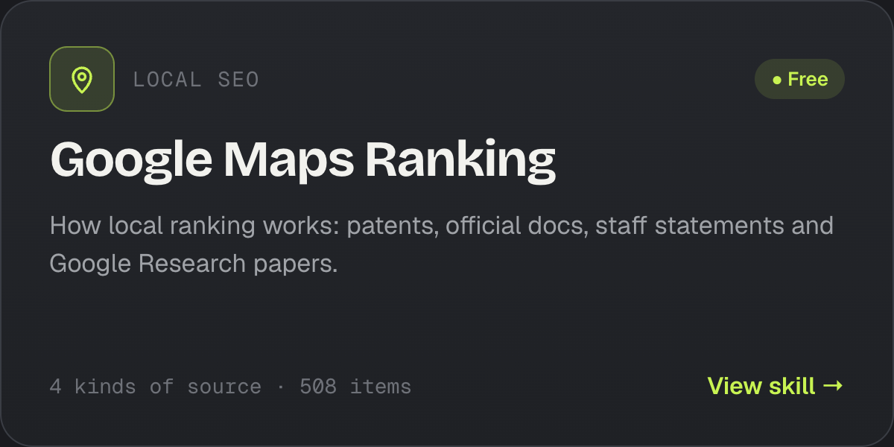</a></td>
</tr>
<tr>
<td width="50%"><a href="skills/google-patents">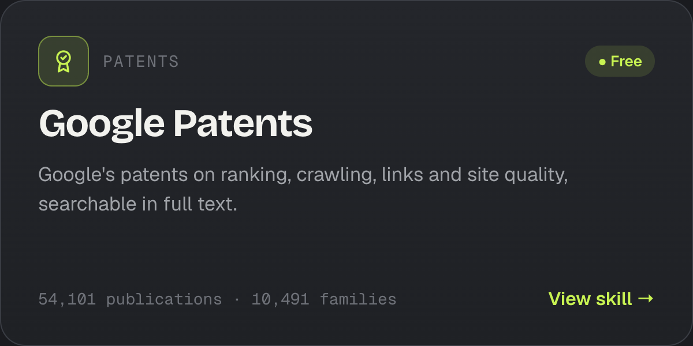</a></td>
<td width="50%"><a href="skills/google-ai-patents">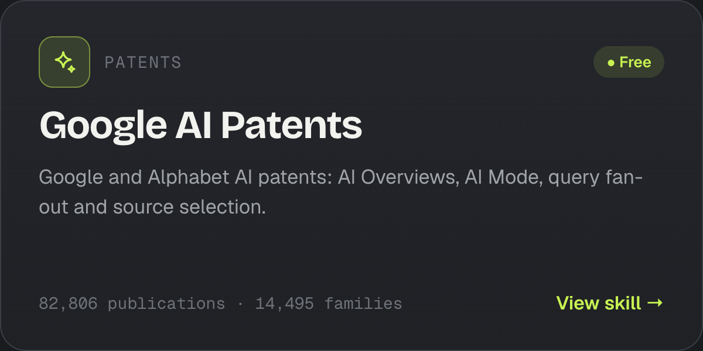</a></td>
</tr>
<tr>
<td width="50%"><a href="skills/llm-patents">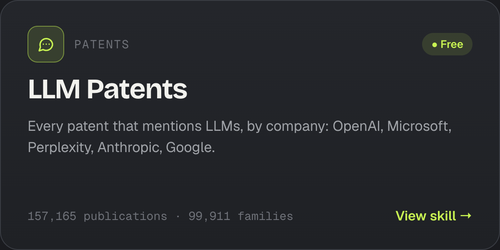</a></td>
<td width="50%"><a href="skills/google-search-docs">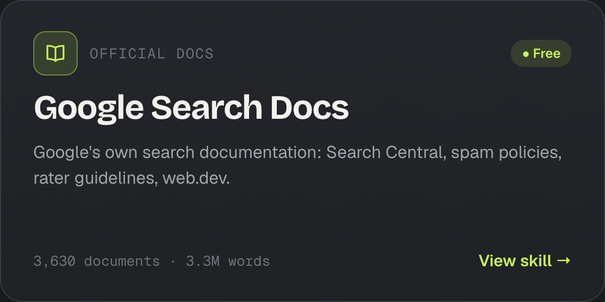</a></td>
</tr>
<tr>
<td width="50%"><a href="skills/google-staff-statements">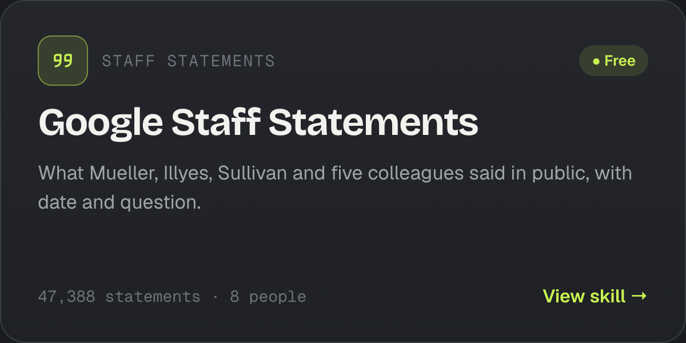</a></td>
<td width="50%" align="center"><a href="#install"><b>Install all seven →</b></a></td>
</tr>
</table>

| Skill | Archive | Ask it about |
|---|---|---|
| [**Google Leak**](skills/google-leak) | Leaked Content Warehouse API docs: 2,756 schemas, 15,050 fields | NavBoost, siteAuthority, click signals, demotions, host age, dates |
| [**Google Maps Ranking**](skills/google-maps-ranking) | 326 patent families, 111 official docs, 45 staff statements, 26 research papers | Local SEO, Google Business Profile, reviews, categories, business names, distance |
| [**Google Patents**](skills/google-patents) | 54,101 publications in 10,491 families, full text | Links and PageRank, reasonable surfer, site quality, freshness, query rewriting |
| [**Google AI Patents**](skills/google-ai-patents) | 82,806 publications in 14,495 families | AI Overviews, AI Mode, query fan-out, source selection, generative search |
| [**LLM Patents**](skills/llm-patents) | 157,165 publications that mention LLMs, by company | OpenAI, Microsoft, Perplexity, Anthropic, Google: citations, RAG, LLM search, GEO |
| [**Google Search Docs**](skills/google-search-docs) | 3,630 official Google documents | Spam policies, canonicals, robots.txt, structured data, E-E-A-T, Core Web Vitals |
| [**Google Staff Statements**](skills/google-staff-statements) | 47,388 statements by eight Google Search people | What Mueller, Illyes, Splitt, Sullivan and others said, with date and question |

Each skill has its own page on [seoskills.io](https://seoskills.io/#skills) with an example answer and the limits of its sources.

### See each skill answer

Every example below uses the skill's real archive: the quote, the field name and the patent number come from the search shown on the right.

<details>
<summary><b>Google Leak: is changing the publish date enough?</b></summary>
<br>

</details>

<details>
<summary><b>Google Maps Ranking: keywords in a Business Profile name</b></summary>
<br>
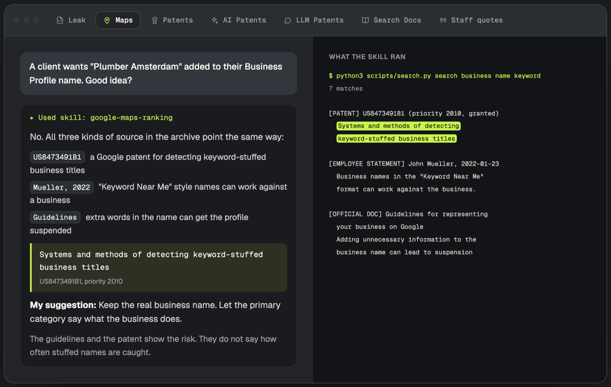
</details>

<details>
<summary><b>Google Patents: does link position matter?</b></summary>
<br>
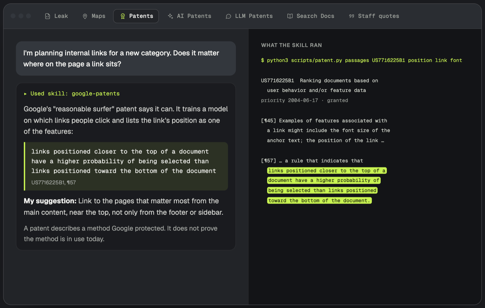
</details>

<details>
<summary><b>Google AI Patents: getting cited in AI Overviews</b></summary>
<br>
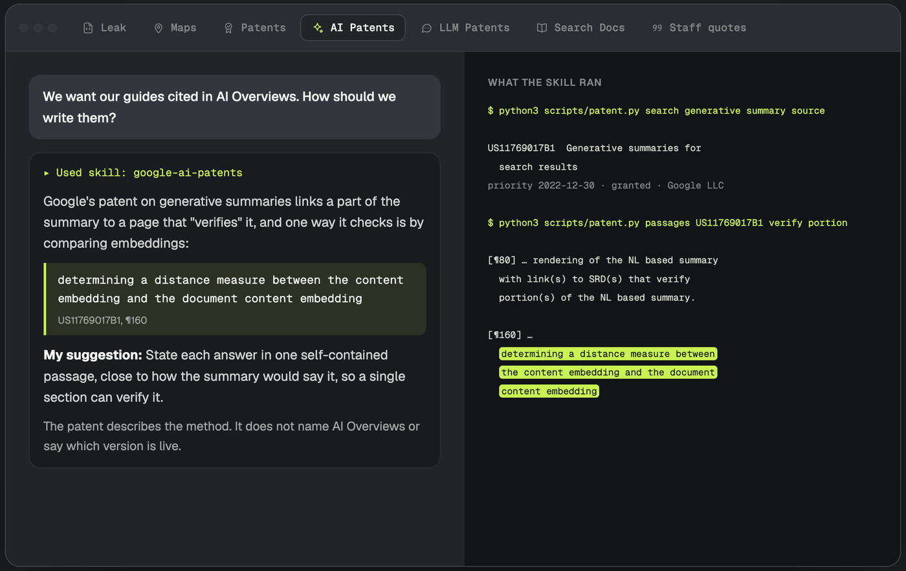
</details>

<details>
<summary><b>LLM Patents: how ChatGPT search picks sources</b></summary>
<br>
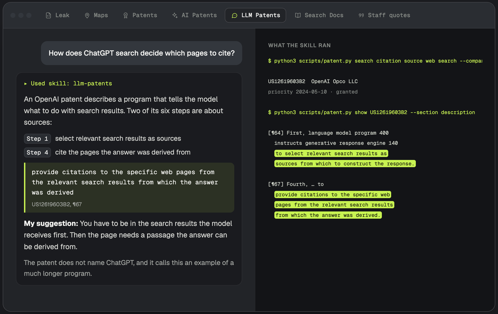
</details>

<details>
<summary><b>Google Search Docs: 500 AI-generated location pages</b></summary>
<br>
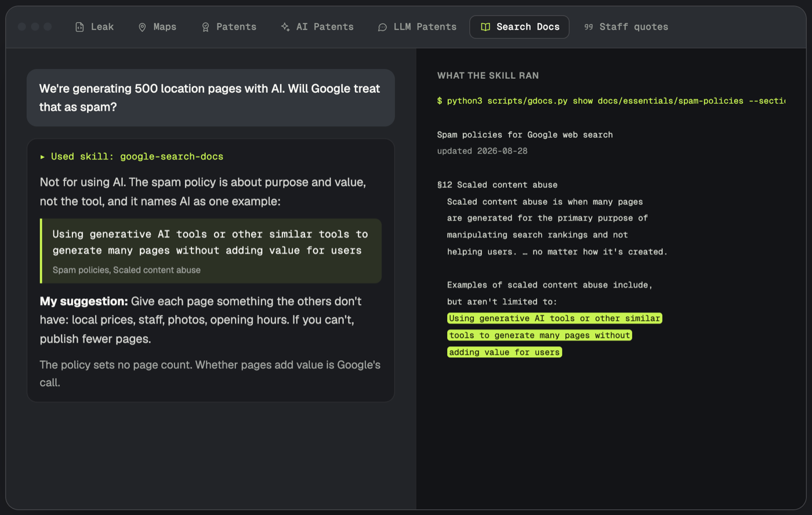
</details>

<details>
<summary><b>Google Staff Statements: should I disavow these links?</b></summary>
<br>
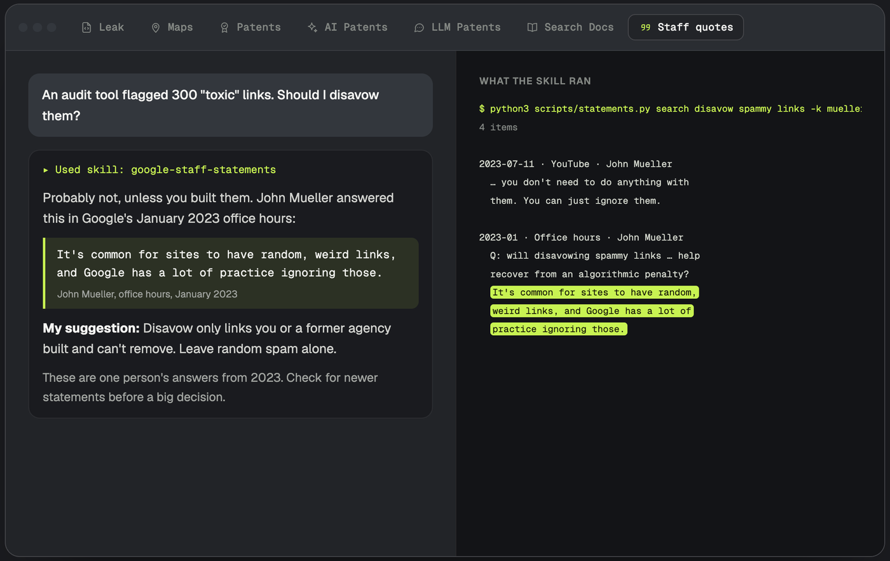
</details>


<p align="center"></p>

## Install

### Claude Code (recommended): plugin marketplace

Add this repository as a marketplace and install the plugin. All seven skills install at once and update with the repository.

```text
/plugin marketplace add mirackacmazcom/seo-skills
/plugin install seo-skills@seo-skills
```

The skills are then available as `/seo-skills:google-leak`, `/seo-skills:google-patents` and so on.

### Claude Code: one skill or all seven from the website

```bash
mkdir -p ~/.claude/skills
curl -L https://seoskills.io/downloads/seoskills-all.zip -o /tmp/seoskills-all.zip
unzip -o /tmp/seoskills-all.zip -d ~/.claude/skills/
```

Replace `seoskills-all` with a skill name, such as `google-leak`, to install one skill. Claude Code picks up the new folders in the session you have open; if a skill does not appear, start a new session. On Windows, run these commands in WSL or Git Bash, or download the ZIP and extract it into `%USERPROFILE%\.claude\skills`.

### From this repository with git

```bash
git clone https://github.com/mirackacmazcom/seo-skills.git
cp -r seo-skills/skills/* ~/.claude/skills/
```

### Other agents

The skills follow the open [Agent Skills](https://agentskills.io) format, so the same folders work in other agents. Copy them into the agent's skills folder:

| Agent | Personal skills folder | Project folder | Call a skill by name |
|---|---|---|---|
| Claude Code | `~/.claude/skills/` | `.claude/skills/` | `/google-leak` |
| Codex | `~/.agents/skills/` | `.agents/skills/` | `$google-leak` |
| Cursor | `~/.cursor/skills/` | `.cursor/skills/` | type `/` in Agent chat |
| Gemini CLI | `~/.gemini/skills/` | `.gemini/skills/` | ask; it requests permission |
| VS Code Copilot | `~/.copilot/skills/` | `.github/skills/` | type `/` in chat |
| OpenCode | `~/.config/opencode/skills/` | `.opencode/skills/` | ask; the agent loads it |

`~/.agents/skills/` is read by Codex, Cursor, Gemini CLI and OpenCode, so one copy there covers several agents:

```bash
mkdir -p ~/.agents/skills
cp -r seo-skills/skills/* ~/.agents/skills/
```

More detail per agent: [seoskills.io/agents](https://seoskills.io/agents/).

### Claude apps (claude.ai, desktop, mobile)

Download a skill's ZIP from its page on [seoskills.io](https://seoskills.io/#skills), then in Claude open **Customize → Skills → + → Create skill → Upload a skill** and choose the ZIP. Code execution must be on (**Settings → Capabilities**). Or connect the [MCP server](#mcp-server), which gives Claude all seven tools without uploading anything.

### Requirements

Python 3 and internet access. No other packages, no account and no API key.

<p align="center"></p>

## How to use the skills

**Just ask.** The agent reads the short description of every installed skill and uses the right one when your question calls for it. You do not need to name the skill.

```text
I'm about to redirect 300 old posts to one guide. What do the sources say?
```

**Or call a skill by name** when you want a specific archive (`/seo-skills:google-leak` when you installed the plugin):

```text
/google-leak Is there a field for host age?
/google-patents What does the reasonable surfer patent say about link position?
/google-search-docs Is E-E-A-T a ranking factor?
```

Good questions name a plan or a claim to check, not just a topic. The skills are built to say what the source supports, suggest what to do, and mark where the evidence stops, so you can act on it.

<p align="center"></p>

## Answer settings

You decide how the answers look. Say it in the chat, or set it once.

| Setting | Default | You can ask for |
|---|---|---|
| 🌍 Language | The language you write in | A fixed language, for example "always answer in Dutch" |
| 📏 Length | Standard: the direct answer, then the one to three sources it rests on | `brief` (two or three sentences) or `detailed` (up to six sources, grouped by theme) |
| 🔗 Sources | On: quotes, source names, dates and links | `off`: a plain answer without quotes or links |

**In the chat**, write it the way you would say it. A preference such as "keep it short" holds for the rest of the conversation; "give me the long version of that" changes one answer:

```text
Shorter please, and skip the sources.
```

**Once, for every conversation**, add one line that starts with `SEO Skills:` to your agent's instruction file (`CLAUDE.md` for Claude Code, `AGENTS.md` for Codex and other agents, or the project instructions in the Claude apps):

```text
SEO Skills: detailed answers, sources off, always answer in Dutch
```

The settings work the same in all seven skills and through the MCP server. Turning sources off changes what you see, not how the answer is made: the skill still searches the archive first and shows the sources again as soon as you ask. A warning that changes the conclusion, such as "a patent does not prove Google uses this", stays in.

<p align="center"></p>

## MCP server

The same seven search tools are available as a remote MCP server, for clients that cannot run scripts or have no network access from their sandbox:

```text
https://mcp.seoskills.io/mcp
```

Claude Code:

```bash
claude mcp add --transport http seoskills https://mcp.seoskills.io/mcp
```

Claude apps: **Settings → Connectors → Add custom connector** and paste the URL. Any client that supports remote MCP over Streamable HTTP works the same way.

<p align="center"></p>

## How it works

<p align="center">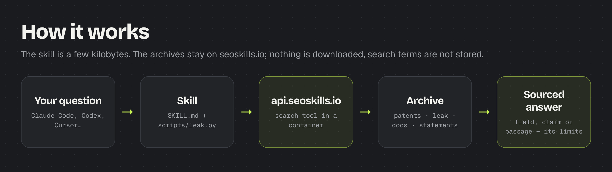</p>

A skill is a folder with a `SKILL.md` file, reference notes and a small Python script. The archives behind these skills are several gigabytes, so they stay on seoskills.io: the script sends its arguments to `api.seoskills.io`, where the search tool runs, and prints the answer. Nothing is downloaded, search terms are not logged or linked to you (results are cached for up to an hour so repeat searches are fast), and the script uses only the Python standard library. Read `scripts/` in any skill folder to see exactly what it sends. Fair use limits apply: 60 searches a minute and 2,000 a day per connection, far more than normal use needs.

```
skills/google-leak/
├── SKILL.md              # when and how the agent uses the skill, and the evidence rules
├── references/           # topic map and background notes the agent can read
└── scripts/leak.py       # sends the search to api.seoskills.io and prints the result
```

<p align="center"></p>

## What each kind of source can and cannot show

Every skill tells the agent what its source proves, so an answer does not turn one kind of evidence into another.

| Source | Shows | Does not show |
|---|---|---|
| Leaked documentation | That a value is stored, and how Google's engineers described it | Its weight, or whether it is used in ranking today |
| Patents | That Google described a method and sought protection for it | That the method is in use |
| Official documentation | What Google recommends, supports and treats as a violation | Ranking weights or a full list of signals |
| Staff statements | Google's comment on one question at one moment | A permanent rule; positions change |

<p align="center"></p>

## FAQ

**Are the skills free?**
Yes. No account, no API key, no paid plan.

**Which AI agents do they work with?**
Claude Code, the Claude apps, Codex, Cursor, Gemini CLI, GitHub Copilot in VS Code and OpenCode, plus any client that supports remote MCP servers.

**Do I need an SEO tool subscription?**
No. The skills search their own archives of public primary sources. They work alongside SEO tools such as Ahrefs or Semrush MCP servers: the tool gives you your data, the skill tells you what Google's documents say about it.

**Where does the data come from?**
Public sources: the Content Warehouse API documentation as it appeared in Google's public API client repositories, patent offices and Google Patents Public Data, Google's own documentation sites, and public posts, videos and interviews by Google's search team. Each skill page lists its sources and the date of its archive.

**Do the archives get updated?**
Yes, on the server. A skill always searches the current version without reinstalling.

**Will a skill tell me how to rank?**
No skill can. It tells you what the source says, what it does not say, and keeps its own suggestions separate from the evidence.

**Can I read what a skill does before installing it?**
Yes, and you should. Each skill is plain text and one short Python script in this repository.

<p align="center"></p>

## License

[MIT](LICENSE). The license covers the skill files in this repository. The archives and the search service at seoskills.io are not part of the repository.

---

Made by [SEO Skills](https://seoskills.io). Questions, wrong quotes or missing sources: [contact@seoskills.io](mailto:contact@seoskills.io) or [open an issue](https://github.com/mirackacmazcom/seo-skills/issues).
