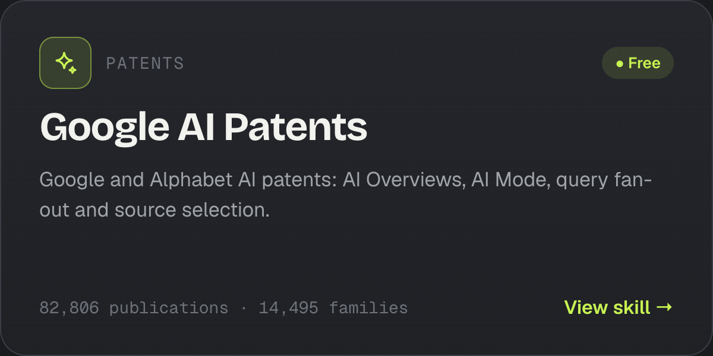
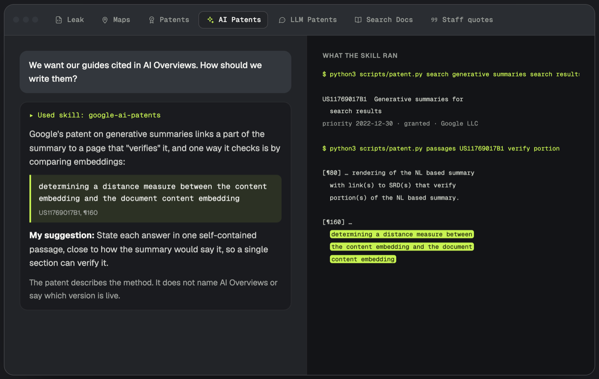

# Google AI Patents skill for Claude and AI agents

<p align="center"></p>

Search 82,806 AI patent publications from Google and Alphabet: generative search, AI Overviews, AI Mode, query fan-out and source selection.

Part of [SEO Skills](../../README.md), free skills that answer from primary sources. Full page with an example answer: [seoskills.io/skills/google-ai-patents](https://seoskills.io/skills/google-ai-patents/).

## Ask it

- "How does Google pick sources for AI Overviews?"
- "Is there a patent for query fan-out?"
- "How should we write guides so they get cited in AI answers?"

The agent uses the skill when your question calls for it. To call it by name in Claude Code: `/google-ai-patents` (or `/seo-skills:google-ai-patents` when installed as a plugin).

## See it answer



## Install

All seven skills as a Claude Code plugin:

```text
/plugin marketplace add mirackacmazcom/seo-skills
/plugin install seo-skills@seo-skills
```

Or only this skill:

```bash
mkdir -p ~/.claude/skills
curl -L https://seoskills.io/downloads/google-ai-patents.zip -o /tmp/google-ai-patents.zip
unzip -o /tmp/google-ai-patents.zip -d ~/.claude/skills/
```

Other agents (Codex, Cursor, Gemini CLI, Copilot, OpenCode): see the [install section](../../README.md#install).

## What is in this folder

- `SKILL.md`: when the agent should use the skill, the search commands and the rules for quoting sources
- `references/`: topic map and background notes the agent can read
- `scripts/patent.py`: sends the search to api.seoskills.io and prints the result, for example `python3 scripts/patent.py search generative summary source --ai`

The archive itself stays on seoskills.io. Search terms are sent to run the search and are not stored.
