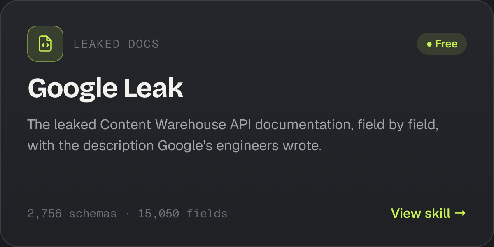
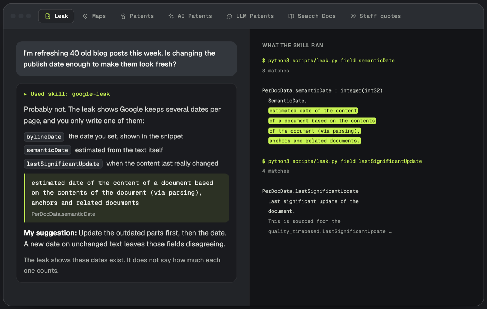

# Google Leak skill for Claude and AI agents

<p align="center"></p>

Search the leaked Google Content Warehouse API documentation: 2,756 schemas and 15,050 fields, with the description Google's engineers wrote for each one.

Part of [SEO Skills](../../README.md), free skills that answer from primary sources. Full page with an example answer: [seoskills.io/skills/google-leak](https://seoskills.io/skills/google-leak/).

## Ask it

- "Is there a field for host age?"
- "What does the leak say about NavBoost and click data?"
- "I'm refreshing old posts. Does the leak store more than one date per page?"

The agent uses the skill when your question calls for it. To call it by name in Claude Code: `/google-leak` (or `/seo-skills:google-leak` when installed as a plugin).

## See it answer



## Install

All seven skills as a Claude Code plugin:

```text
/plugin marketplace add mirackacmazcom/seo-skills
/plugin install seo-skills@seo-skills
```

Or only this skill:

```bash
mkdir -p ~/.claude/skills
curl -L https://seoskills.io/downloads/google-leak.zip -o /tmp/google-leak.zip
unzip -o /tmp/google-leak.zip -d ~/.claude/skills/
```

Other agents (Codex, Cursor, Gemini CLI, Copilot, OpenCode): see the [install section](../../README.md#install).

## What is in this folder

- `SKILL.md`: when the agent should use the skill, the search commands and the rules for quoting sources
- `references/`: topic map and background notes the agent can read
- `scripts/leak.py`: sends the search to api.seoskills.io and prints the result, for example `python3 scripts/leak.py field siteAuthority`

The archive itself stays on seoskills.io. Search terms are sent to run the search and are not stored.
