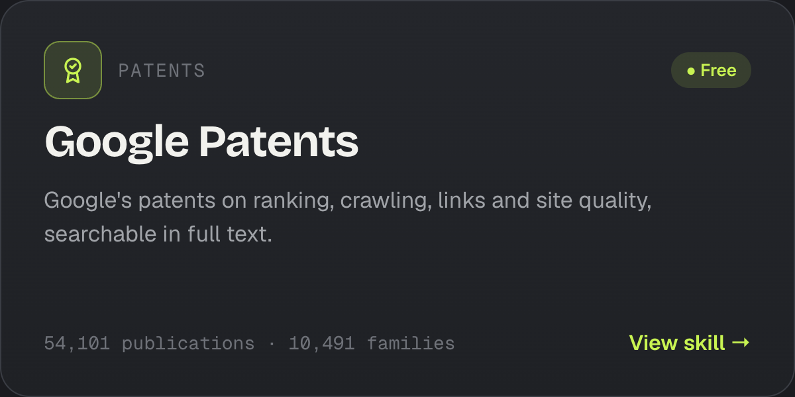
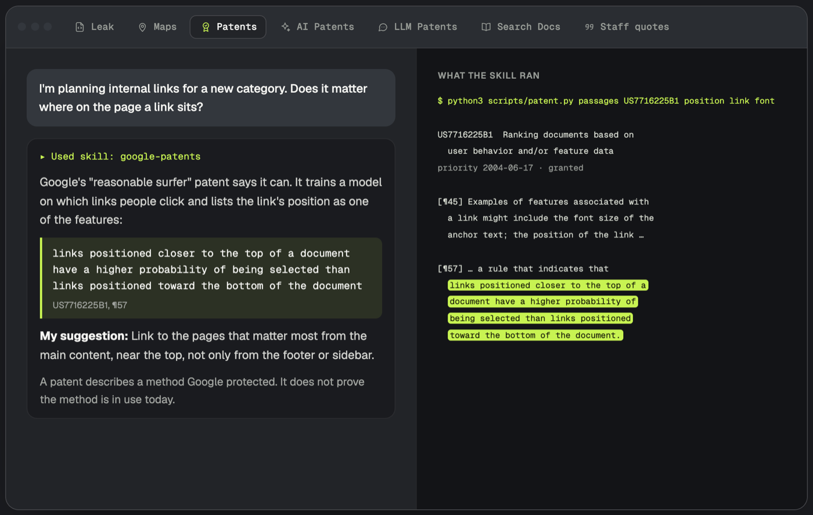

# Google Patents skill for Claude and AI agents

<p align="center"></p>

Search 54,101 Google patent publications on ranking, crawling, links, site quality and AI search, in full text, and answer with the patent number and paragraph.

Part of [SEO Skills](../../README.md), free skills that answer from primary sources. Full page with an example answer: [seoskills.io/skills/google-patents](https://seoskills.io/skills/google-patents/).

## Ask it

- "Does it matter where on the page a link sits?"
- "What does the Navboost patent actually claim?"
- "Someone says Google patented X. Is that true?"

The agent uses the skill when your question calls for it. To call it by name in Claude Code: `/google-patents` (or `/seo-skills:google-patents` when installed as a plugin).

## See it answer



## Install

All seven skills as a Claude Code plugin:

```text
/plugin marketplace add mirackacmazcom/seo-skills
/plugin install seo-skills@seo-skills
```

Or only this skill:

```bash
mkdir -p ~/.claude/skills
curl -L https://seoskills.io/downloads/google-patents.zip -o /tmp/google-patents.zip
unzip -o /tmp/google-patents.zip -d ~/.claude/skills/
```

Other agents (Codex, Cursor, Gemini CLI, Copilot, OpenCode): see the [install section](../../README.md#install).

## Answer settings

Answers come in the language you write in, short and with sources. Ask for a brief or detailed answer, a fixed language, or no sources: see [answer settings](../../README.md#answer-settings).

## What is in this folder

- `SKILL.md`: when the agent should use the skill, the search commands and the rules for quoting sources
- `references/`: topic map and background notes the agent can read
- `scripts/patent.py`: sends the search to api.seoskills.io and prints the result, for example `python3 scripts/patent.py search reasonable surfer`

The archive itself stays on seoskills.io. Search terms are sent only to run the search. They are not logged or linked to you; results are cached for up to an hour so repeat searches are fast.
