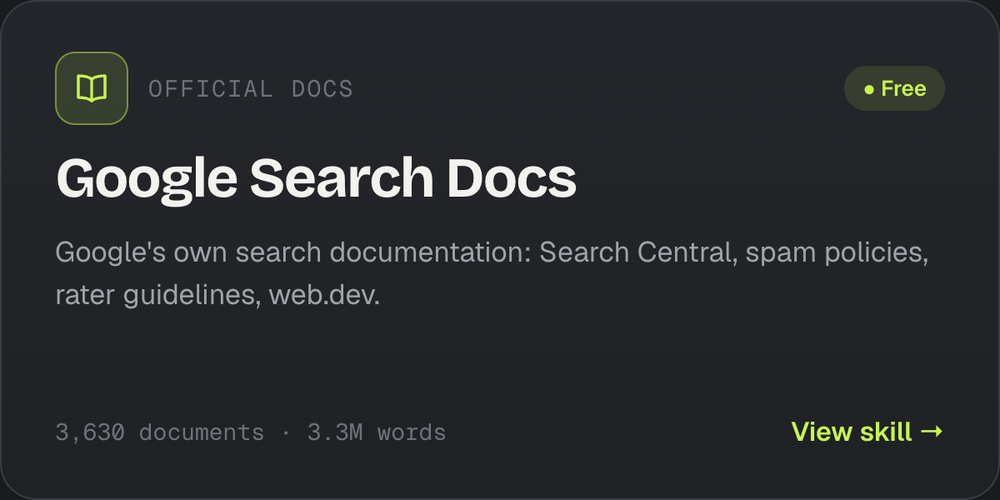
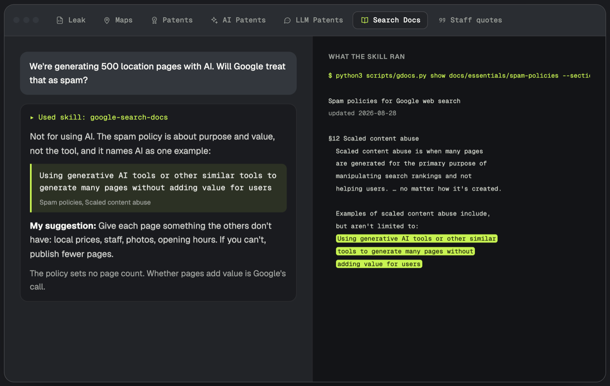

# Google Search Docs skill for Claude and AI agents

<p align="center"></p>

Search 3,630 official Google documents on search and SEO, from Search Central and its blog to the Quality Rater Guidelines and web.dev, and quote them exactly.

Part of [SEO Skills](../../README.md), free skills that answer from primary sources. Full page with an example answer: [seoskills.io/skills/google-search-docs](https://seoskills.io/skills/google-search-docs/).

## Ask it

- "Is E-E-A-T a ranking factor?"
- "We're generating 500 location pages with AI. Is that spam?"
- "What is the current INP threshold?"

The agent uses the skill when your question calls for it. To call it by name in Claude Code: `/google-search-docs` (or `/seo-skills:google-search-docs` when installed as a plugin).

## See it answer



## Install

All seven skills as a Claude Code plugin:

```text
/plugin marketplace add mirackacmazcom/seo-skills
/plugin install seo-skills@seo-skills
```

Or only this skill:

```bash
mkdir -p ~/.claude/skills
curl -L https://seoskills.io/downloads/google-search-docs.zip -o /tmp/google-search-docs.zip
unzip -o /tmp/google-search-docs.zip -d ~/.claude/skills/
```

Other agents (Codex, Cursor, Gemini CLI, Copilot, OpenCode): see the [install section](../../README.md#install).

## What is in this folder

- `SKILL.md`: when the agent should use the skill, the search commands and the rules for quoting sources
- `references/`: topic map and background notes the agent can read
- `scripts/gdocs.py`: sends the search to api.seoskills.io and prints the result, for example `python3 scripts/gdocs.py show docs/essentials/spam-policies --section 12`

The archive itself stays on seoskills.io. Search terms are sent to run the search and are not stored.
