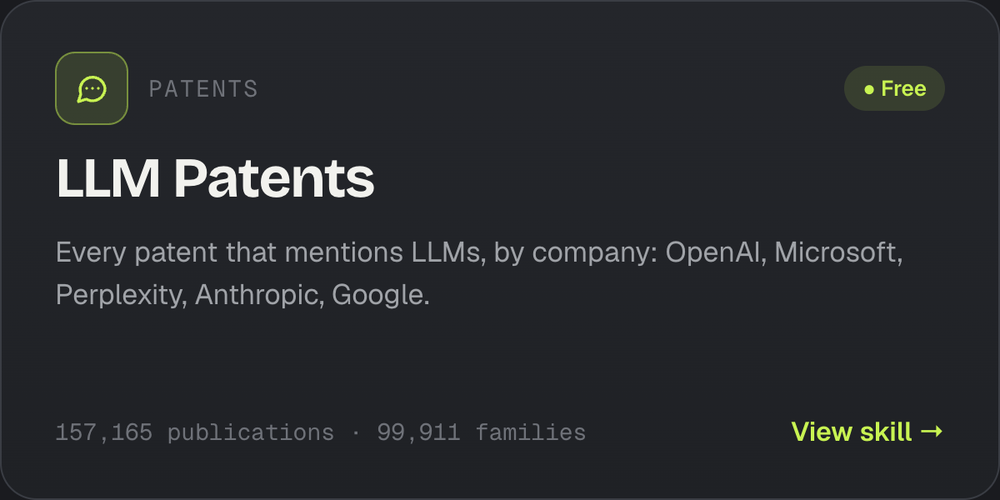
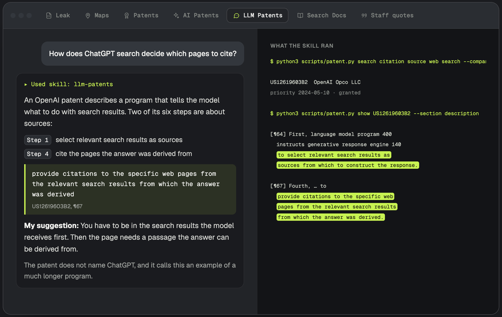

# LLM Patents skill for Claude and AI agents

<p align="center"></p>

Search 157,165 patent publications that mention large language models, filterable by company: OpenAI, Microsoft, Perplexity, Anthropic, Google and more.

Part of [SEO Skills](../../README.md), free skills that answer from primary sources. Full page with an example answer: [seoskills.io/skills/llm-patents](https://seoskills.io/skills/llm-patents/).

## Ask it

- "How does ChatGPT search decide which pages to cite?"
- "Does OpenAI have a patent on function calling?"
- "Is there a patent behind this GEO claim?"

The agent uses the skill when your question calls for it. To call it by name in Claude Code: `/llm-patents` (or `/seo-skills:llm-patents` when installed as a plugin).

## See it answer



## Install

All seven skills as a Claude Code plugin:

```text
/plugin marketplace add mirackacmazcom/seo-skills
/plugin install seo-skills@seo-skills
```

Or only this skill:

```bash
mkdir -p ~/.claude/skills
curl -L https://seoskills.io/downloads/llm-patents.zip -o /tmp/llm-patents.zip
unzip /tmp/llm-patents.zip -d ~/.claude/skills/
```

Other agents (Codex, Cursor, Gemini CLI, Copilot, OpenCode): see the [install section](../../README.md#install).

## What is in this folder

- `SKILL.md`: when the agent should use the skill, the search commands and the rules for quoting sources
- `references/`: topic map and background notes the agent can read
- `scripts/patent.py`: sends the search to api.seoskills.io and prints the result, for example `python3 scripts/patent.py search citation web search --company openai`

The archive itself stays on seoskills.io. Search terms are sent to run the search and are not stored.
